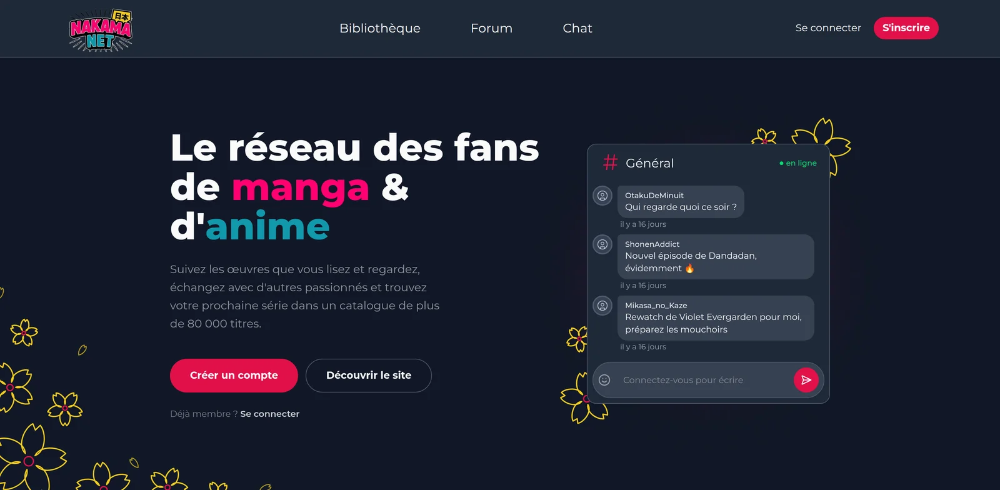

# NAKAMANET — le réseau des fans de manga & d'anime



<p align="center">
  
  
  
  
  
  
  
  
  
</p>

🌐 **Site en ligne : [nakamanet.fr](https://nakamanet.fr)**

Plateforme communautaire dédiée à la culture manga et anime : on y suit ses lectures et ses
visionnages, on découvre de nouvelles œuvres dans un catalogue de plus de 80 000 titres, et
surtout on échange avec d'autres fans, en temps réel. Projet de fin d'études de la Web@cademie
by Epitech, réalisé d'octobre 2025 à octobre 2026, en alternance.

> **Code source privé.** Ce dépôt est une vitrine du projet : le code n'est pas publié pour
> l'instant. Les détails techniques ci-dessous décrivent l'application telle qu'elle est déployée.

## Fonctionnalités

- **Catalogue** d'animes et de mangas (fiches, épisodes, chapitres, personnages, staff, genres),
  avec recherche, filtres et pagination
- **Recherche sémantique par IA** : on décrit une intrigue ou un concept (« un garçon avec un
  chapeau de paille ») et le moteur retrouve œuvres, membres et posts, sans connaître le titre exact
- **Bibliothèque personnelle** : suivi de progression par statut (à lire / à regarder, en cours,
  terminé, en pause, abandonné) et favoris
- **Fil d'actualité** : posts, commentaires, likes, mentions, balise spoiler
- **Chat en temps réel** par salons (Socket.io) et **messages privés**
- **Forum** de discussion par sujets
- **Social** : profils personnalisables (avatar recadrable), amis, blocage, notifications
  avec préférences
- **Traduction** à la volée du contenu (français / anglais)
- **Modération** : signalements, gestion des comptes, des rôles et des salons depuis un panneau
  d'administration
- **Comptes sécurisés** : authentification JWT, vérification de l'e-mail, Cloudflare Turnstile
  contre les robots
- Interface **dark-first**, responsive et pensée mobile first (barre de navigation basse sur mobile)

## Stack

| Couche        | Techno                                                                 |
| ------------- | ---------------------------------------------------------------------- |
| Front         | Next.js 15, React 19, TypeScript, Tailwind CSS 4, DaisyUI 5, TanStack Query |
| API principale | Laravel 12 (PHP 8.2+), JWT, Pest — comptes, posts, forum, bibliothèque, admin |
| API catalogue | AdonisJS 7 (TypeScript) — catalogue anime/manga, chat Socket.io        |
| IA            | FastAPI (Python), Sentence-Transformers `all-MiniLM-L6-v2`             |
| Données       | PostgreSQL 16 (utilisateurs, catalogue), MongoDB 7 (messages), Redis 7 |
| Stockage      | Cloudflare R2 (images), Resend (e-mails)                               |
| Production    | Docker, VPS OVHcloud, Cloudflare (DNS, HTTPS)                          |

## Sommaire

1. [Architecture](#architecture)
2. [Recherche sémantique](#recherche-sémantique)
3. [Organisation](#organisation)
4. [Pistes d'amélioration](#pistes-damélioration)
5. [Collaborateurs](#collaborateurs)

---

## Architecture

NAKAMANET repose sur une architecture **microservices** : chaque domaine a sa technologie et sa
base de données, et chaque service vit dans son propre dépôt et son propre conteneur Docker.

```
                         ┌──────────────────────────┐
                         │   Front — Next.js 15     │
                         │  Tailwind · DaisyUI      │
                         └──┬──────────┬─────────┬──┘
                REST · JWT  │   REST · Socket.io │  REST
               ┌────────────┘          │         └─────────────┐
               ▼                       ▼                       ▼
   ┌───────────────────────┐ ┌──────────────────────┐ ┌──────────────────────┐
   │   Laravel 12          │ │   AdonisJS 7         │ │   FastAPI            │
   │ comptes · posts ·     │ │ catalogue anime/manga│ │ recherche sémantique │
   │ forum · bibliothèque ·│ │ chat temps réel      │ │ (embeddings)         │
   │ notifications · admin │ │                      │ │                      │
   └──────────┬────────────┘ └──┬────────┬──────┬──┘ └──────────┬───────────┘
              ▼                 ▼        ▼      ▼               │ lecture seule
        PostgreSQL        PostgreSQL  MongoDB  Redis  ◄─────────┘ (index reconstruit
        (utilisateurs)    (catalogue) (messages)                    toutes les 24 h)
```

- Le **front** Next.js profite du rendu hybride pour que les fiches d'œuvres soient indexables
- **Laravel** porte le cœur de l'application ; une base de test PostgreSQL isolée (en RAM) garantit
  qu'aucun test ne peut toucher la base de production
- **AdonisJS** sert le catalogue, alimenté à partir de l'API Kitsu et de jeux de données ouverts,
  et gère le chat via Socket.io avec MongoDB pour l'historique des messages

## Recherche sémantique

Le catalogue dépasse les 84 000 entrées : calculer les vecteurs à la volée ralentissait trop le
serveur. Le microservice FastAPI sépare donc deux processus dans le même conteneur :

1. **Un worker d'indexation** qui lit les bases en lecture seule, encode toutes les entités
   textuelles et enregistre la matrice d'embeddings dans un fichier compact, reconstruit toutes
   les 24 heures
2. **Un serveur API** qui charge cet index en mémoire et répond quasi instantanément ; tant que
   l'index est en construction, il renvoie un message d'attente au lieu de bloquer

Le score de pertinence combine **similarité cosinus** et correspondance exacte sur le texte.

## Organisation

- **Scrum** : sprints de 2 à 4 semaines, backlog de user stories priorisées dans Jira, un
  incrément testé à chaque fin de sprint
- **Alternance** : une semaine par mois en présentiel, le reste à distance — communication
  asynchrone sur Discord (canaux dev, design, admin, notifications Git)
- **Workflow Git** : une branche par intervention, préfixée selon son type (`[DEV]`, `[FIX]`,
  `[WIP]`, `[DOC]`, `[DELETE]`), Pull Request revue par au moins un autre développeur avant
  fusion dans `dev`, puis `main` pour les livraisons
- **Documents de cadrage** : cahier des charges, analyses SWOT et PESTEL, étude de la
  concurrence (MyAnimeList, AniList, Kitsu), plannings Gantt nominal et pessimiste

## Pistes d'amélioration

- Import des listes depuis MyAnimeList et AniList
- Watch parties et calendrier des sorties enrichi
- Recommandations personnalisées à partir de la bibliothèque de chaque membre
- Abonnement optionnel Nakama+ (sans publicité, badges, thèmes)
- Supervision centralisée (logs ELK, métriques Grafana)

## Collaborateurs

- **Léa Ballester** — direction de projet, full stack
- **Rémi Bouyeda** — architecture, back-end
- **Gauthier Watelain** — front-end, UI/UX
- **Stefan-Paris Paduraru** — IA, infrastructure, full stack

_Projet de fin d'études réalisé dans le cadre de la Web@cademie by Epitech Marseille — Promo 2026_
